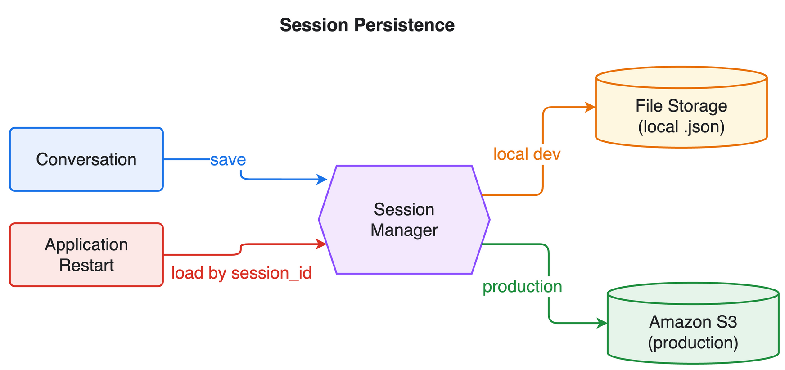

# Module 4: Session Managers

Add persistence to the customer service agent. Stop it, restart it, and watch it remember the previous conversation.

## What you'll build

An agent backed by a **session manager** that saves state to disk and reloads it on restart — so a new agent instance with the same `session_id` keeps its memory. It uses `SnapshotSessionManager`, the recommended manager for new single-agent sessions, together with `context_manager="auto"` to manage what stays in the model's context.

## Architecture



The session manager persists agent state outside the process. `SnapshotSessionManager` saves the whole agent as one atomic blob through a unified `Storage` backend (`LocalFileStorage` for dev, `S3Storage` for production). The older `FileSessionManager`/`S3SessionManager` persist each message as a separate record. Either way, recreating the agent with the same `session_id` restores the prior conversation.

## Files

| File | Purpose |
|------|---------|
| `module-04-session-managers.ipynb` | Walkthrough: no-persistence problem → add session manager → restart and remember |
| `chat.py` | Terminal chat backed by `SnapshotSessionManager` |
| `steering_handlers.py` | Steering handlers carried over from Module 3 |
| `skills/` | Workflow skills carried over from Module 3 |
| `customer_service_tools.py` | Mock tools (shared across modules) |

## Which session manager should I use?

| Session Manager | Use When |
|---|---|
| **SnapshotSessionManager** | New single-agent sessions. Recommended default. Saves the whole agent as one atomic blob and supports immutable checkpoints. |
| **FileSessionManager** | Existing record-based sessions, or multi-agent (Graph/Swarm) persistence. |
| **S3SessionManager** | Same as FileSessionManager but backed by Amazon S3 instead of local disk. |
| **AgentCore Memory** | Production deployments needing intelligent long-term recall alongside session persistence. See [Module 5](../05-deploy/). |

`SnapshotSessionManager` uses the unified `Storage` backend (`LocalFileStorage`, `S3Storage`, `InMemoryStorage`), so you swap the backend without changing your session logic. The older managers (`FileSessionManager`, `S3SessionManager`) still work and are needed for multi-agent orchestration.

## How do I run it?

Open `module-04-session-managers.ipynb` in **VS Code** or **JupyterLab** and run the cells top to bottom. Session files are written to a local `sessions/` folder.

For a multi-turn terminal chat, run `chat.py` and re-run it with the same `--session-id` to see it resume:

```bash
python chat.py
```

## Key concept

```python
from strands.session import SnapshotSessionManager
from strands.storage import LocalFileStorage

session_manager = SnapshotSessionManager(
    session_id="customer-session-001",
    storage=LocalFileStorage("./sessions"),
)
agent = Agent(tools=[...], context_manager="auto", session_manager=session_manager)
```

Recreate the agent later with the same `session_id` and it reloads the saved state. Swap `LocalFileStorage` for `S3Storage` to persist in the cloud without changing your session logic.

## Session vs memory

Session managers handle **conversation persistence** within a single session, so the agent can resume where it left off. For durable knowledge that persists **across** sessions (user preferences, facts, past decisions), Strands has a separate memory layer:

- **Session** = persist the conversation so the agent can resume after a restart.
- **Memory** = durable knowledge across sessions, without replaying past conversations.

They serve different purposes and are often used together. See the [Memory docs](https://strandsagents.com/docs/user-guide/sdk/memory/overview/) for more.

## What's next

**[Module 5: Deploy](../05-deploy/)** packages this same agent and deploys it to Amazon Bedrock AgentCore Runtime with a single CLI command.
